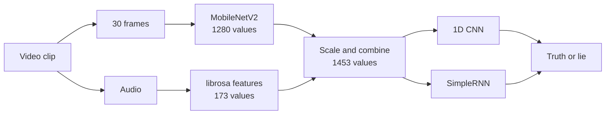

<div align="center">

# AI Truth or Lie Detector

**A deep learning project that predicts whether the person in a short video clip is telling the truth or lying, using both the video frames and the audio.**

[](https://www.python.org/)
[](https://www.tensorflow.org/)
[](https://keras.io/)
[](https://opencv.org/)
[](https://librosa.org/)
[](https://scikit-learn.org/)
[](LICENSE)
[](https://colab.research.google.com/github/KesharaGunathilaka/True-or-Lie-Detector-AI/blob/main/True_or_Lie_Detector_AI_Project.ipynb)

</div>

## How it works



1. Take 30 evenly spaced frames from the clip and resize them to 224×224.
2. Pass the frames through MobileNetV2 (pretrained on ImageNet, frozen) and average the results.
3. Extract the audio with ffmpeg and compute MFCC, chroma, mel spectrogram, spectral contrast and tonnetz features with librosa.
4. Scale both feature sets, join them, and classify with a 1D CNN or a SimpleRNN.

**Built with:** Python, TensorFlow/Keras, OpenCV, librosa, ffmpeg, scikit-learn, Google Colab.

## Dataset

We used clips from the Real-Life Trial Deception Detection data (Pérez-Rosas et al., 2015):

- 829 short clips from 109 courtroom trial videos
- 440 "lie" and 389 "truth" clips
- about 3.7 seconds per clip on average

The videos are not included in this repository.

## Results

Mean validation accuracy over 5 runs with different random seeds:

| Model | Accuracy | Standard deviation |
|---|---|---|
| 1D CNN | 91.3% | 9.8 points |
| SimpleRNN | 74.5% | 6.7 points |

The CNN scored higher, while the RNN varied less between runs. The numbers are saved in [`results/`](results/).

Read them with these limits in mind:

- They are **validation** results on a random 15% split. The provided test folder has only 8 clips.
- Clips from the same trial can appear in both training and validation, so the scores are likely **higher than they would be on new people**. The notebook now splits by trial, but the numbers above were not measured that way.
- The 30 frames are averaged before classification, so neither model learns how things change over time.
- A simple dense network, tried as a comparison, scored higher than both (98.2%).
- The outputs saved in the notebook come from earlier runs and differ from this table.

## Running the project

### Data Setup

Get the dataset from its [authors](https://lit.eecs.umich.edu/downloads.html) and arrange it like this:

```
data/
└── TruthOrLie/
    ├── train/
    │   ├── lie/
    │   └── truth/
    └── test/
        ├── lie/
        └── truth/
```

### Google Colab

1. Zip the `TruthOrLie` folder as `TruthOrLie.zip` and upload it to the top level of your Google Drive.
2. Open the notebook with the Colab button above and select a GPU runtime.
3. Run all cells.

### Local

Install [ffmpeg](https://ffmpeg.org/download.html) first, then:

```bash
git clone https://github.com/KesharaGunathilaka/True-or-Lie-Detector-AI.git
cd True-or-Lie-Detector-AI
pip install -r requirements.txt
jupyter notebook True_or_Lie_Detector_AI_Project.ipynb
```

When running locally, skip the Drive cell and set `DATA_ROOT` to your `data` folder.

To run the tests:

```bash
python -m pytest tests/
```

## Project structure

```
├── True_or_Lie_Detector_AI_Project.ipynb   # data exploration, preprocessing and both models
├── src/        # frame and audio feature extraction
├── scripts/    # run the pipeline and repeat experiments outside Colab
├── tests/      # tests for preprocessing and data splitting
├── results/    # saved metrics
└── docs/       # plots and an animated diagram (architecture.html)
```

## Team

This was a group project for our AI module in Semester 6 (2025):

- Gunarathne A.N.G.T.N.B
- Gunathilaka G.P.K.H
- Piyumantha H.D.D.B.A
- Rajapakshe R.M.M.L.D

## Note

This is a student learning project. It is **not** a reliable lie detector and should not be used to judge real people.

## References

- Pérez-Rosas et al., [Deception Detection using Real-Life Trial Data](https://doi.org/10.1145/2818346.2820758), ICMI 2015
- Sandler et al., [MobileNetV2: Inverted Residuals and Linear Bottlenecks](https://arxiv.org/abs/1801.04381), 2018
- [librosa](https://librosa.org/)

## License

The code is under the [MIT License](LICENSE). The license does not cover the dataset.
