<div align="center">

# AI Truth or Lie Detector

**Multimodal deception detection from courtroom video — fusing frozen-CNN visual embeddings with librosa audio features, then comparing a 1D-CNN against a recurrent head.**

[](https://www.python.org/)
[](https://www.tensorflow.org/)
[](https://keras.io/)
[](https://opencv.org/)
[](https://librosa.org/)
[](https://scikit-learn.org/)
[](LICENSE)
[](https://colab.research.google.com/github/KesharaGunathilaka/True-or-Lie-Detector-AI/blob/deploy/True_or_Lie_Detector_AI_Project.ipynb)

</div>

---

## The Problem

Traditional lie detection relies on polygraphs: intrusive, contested, and requiring physical instrumentation of the subject. The alternative that deep learning promises — inferring deception from ordinary video — is attractive precisely because it needs nothing but a camera.

It is also very easy to get *apparently* excellent results on, and very hard to get *honest* ones. This project builds the full pipeline, gets the excellent result, and then explains why that result is smaller than it looks.

## What It Does

Given a short video clip of a person speaking, the system:

1. **Samples 30 evenly spaced frames** and resizes each to 224×224.
2. **Demuxes the audio** with ffmpeg and computes a 173-dimensional acoustic descriptor.
3. **Encodes the frames** with a frozen ImageNet-pretrained MobileNetV2 into a 1280-d visual embedding.
4. **Fuses** the two modalities into a single 1453-d feature vector.
5. **Classifies** the clip as `lie` or `truth` using one of two heads — a 1D CNN or a SimpleRNN.

The real use case is not a deployable lie detector (see [Ethical Considerations](#ethical-considerations)). It is a study of whether visual and vocal cues carry a machine-learnable deception signal at all, and of how much of an apparently strong result survives a correctly constructed evaluation.

## Results at a Glance

| Metric | CNN head | RNN head |
|---|---|---|
| Accuracy | **98.0%** | 70.2% |
| ROC AUC | **0.9982** | 0.7369 |
| Weighted F1 | **0.9758** | 0.6996 |
| Weighted Precision | **0.9759** | 0.7186 |
| Weighted Recall | **0.9758** | 0.7016 |

> ### ⚠️ Read this before quoting the 98%
>
> Those are **random-split validation** figures, and they are inflated by two distinct problems we found while documenting this project:
>
> 1. **They are not test scores.** The shipped `test/` directory holds only 8 clips — too few to evaluate on — so the pipeline carves 15% off the training data instead. That same split drives `EarlyStopping(restore_best_weights=True)`, making it a *model-selection* score, not a held-out one.
> 2. **Clips from the same trial appear on both sides.** The 829 clips are cut from only **109 source courtroom trials**, averaging 7.6 clips each. A random split puts the same person, in the same room, on both sides of the line. See [The Split Problem](#the-split-problem).
>
> A group-aware split is now implemented (`group_split()` in [`src/preprocessing.py`](src/preprocessing.py)) and enforced by [`tests/test_split_integrity.py`](tests/test_split_integrity.py). **The metrics above have not yet been regenerated under it**, and we expect them to drop substantially when they are. We have left the original numbers labelled rather than quietly deleting them.

## Architecture

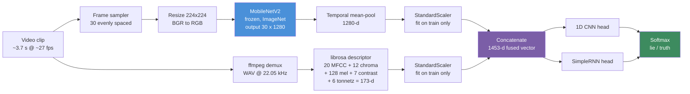

An **animated walkthrough** of this pipeline is available at [`docs/architecture.html`](docs/architecture.html) — open it in any browser.

### Feature Pipeline

Each stage caches its output, so a re-run resumes rather than repeating ~40 minutes of video decoding.

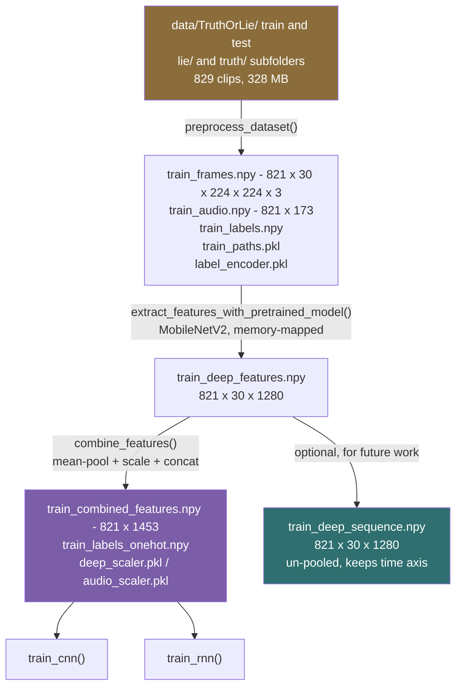

### Model Heads: CNN vs RNN

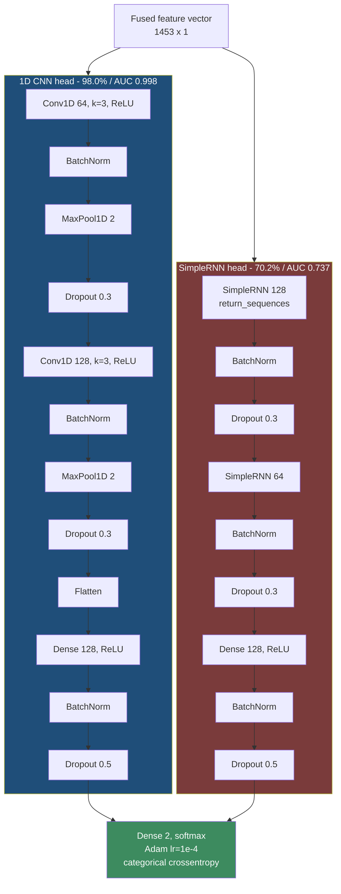

**The catch:** `combine_features()` mean-pools the 30-frame axis away *before* either head runs. The RNN's input of shape `(1453, 1)` is therefore a sequence over **feature indices**, not over time. So this compares two classifier heads on an identical pooled vector — it is **not** a fair test of convolution versus recurrence, and the CNN's win should not be read as one. The un-pooled `(30, 1280)` tensors are now saved so a genuine temporal model can be trained without redoing feature extraction.

## Tech Stack

| Layer | Technology |
|---|---|
| Language | Python 3.11 |
| Deep learning | TensorFlow / Keras |
| Visual encoder | MobileNetV2 (ImageNet, frozen) |
| Video I/O | OpenCV |
| Audio | ffmpeg + librosa |
| Classical ML | scikit-learn — `StandardScaler`, `LabelEncoder`, `GroupShuffleSplit` |
| Data / plotting | NumPy, pandas, matplotlib, seaborn |
| Environment | Google Colab (GPU runtime) |
| Testing | pytest |

## Dataset

Clips are drawn from the **Real-Life Trial Deception Detection** dataset (Pérez-Rosas et al., 2015), segmented into short clips.

| Property | Value |
|---|---|
| Total clips | 829 |
| Source trials | **109** (59 lie, 50 truth) |
| Clips per trial | 2–21, mean 7.6 |
| Class balance | 440 lie / 389 truth (53.1% / 46.9%) |
| Shipped split | 821 train / 8 test |
| Mean duration | 3.74 s |
| Mean frames | ~101 @ ~26.9 fps |
| Clips with no usable audio | 17 |
| Clips with no face detected | 25 |

The dataset is **not redistributed here** — it is licensed for non-commercial academic research only. `data/` is gitignored. See [Data Setup](#data-setup).

`data/TruthOrLie/label.csv` ships with the dataset and maps each clip filename to a `0`/`1` label. The pipeline does not read it; labels are derived from the `lie/` and `truth/` directory names instead. It is kept for reference.

### The Split Problem

This is the most important thing in the repository.

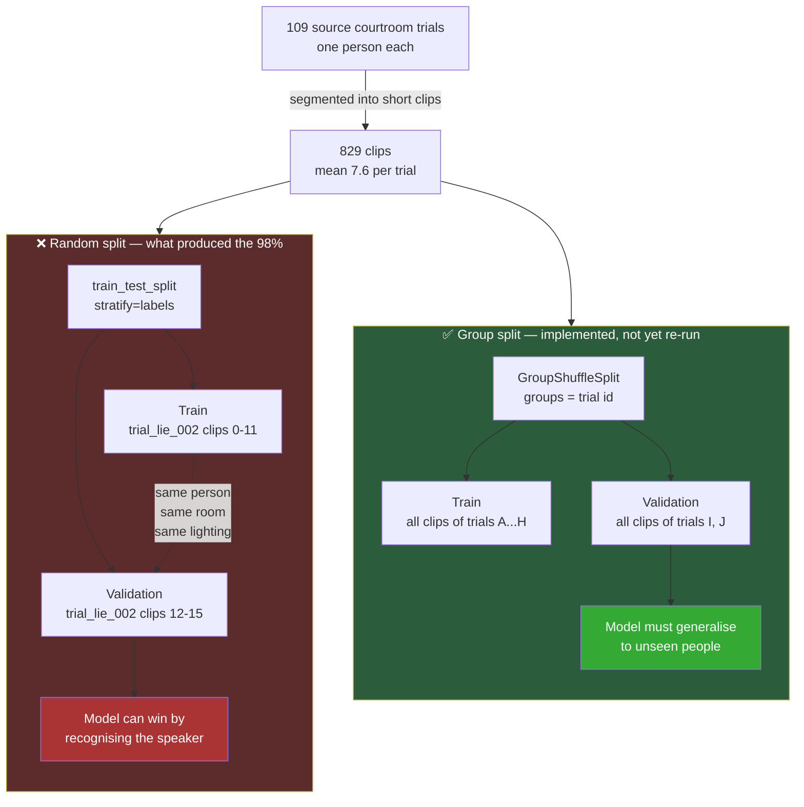

Clips named `trial_lie_002_000` through `trial_lie_002_015` are sixteen fragments of one courtroom video. Under a random split, eleven land in training and four in validation — the model has effectively seen the validation set already.

There is a second, smaller instance of the same bug baked into the dataset directories themselves: **`trial_lie_001` has clips in both `train/` and `test/`.** That is asserted by a deliberately `xfail`-marked test, so the day the directories are re-split correctly, the suite will say so:

```
tests/test_split_integrity.py::test_shipped_directory_split_does_not_share_trials XFAIL
```

## Getting Started

### Option A — Google Colab (recommended)

The notebook was written for and run on Colab; ffmpeg and every dependency are preinstalled there, and feature extraction needs a GPU runtime to finish in reasonable time.

1. Click the **Open In Colab** badge at the top.
2. `Runtime → Change runtime type → GPU`.
3. Upload the dataset archive to your Drive as `MyDrive/TruthOrLie.zip` (see [Data Setup](#data-setup)).
4. `Runtime → Run all`.

The notebook mounts Drive, extracts the archive to `/content/data`, and clones this repo for its `src/` package.

### Option B — Local

```bash
git clone https://github.com/KesharaGunathilaka/True-or-Lie-Detector-AI.git
cd True-or-Lie-Detector-AI
python -m venv .venv && source .venv/bin/activate   # Windows: .venv\Scripts\activate
pip install -r requirements.txt
```

ffmpeg is a **binary dependency** that pip cannot install:

```bash
sudo apt install ffmpeg          # Debian / Ubuntu
brew install ffmpeg              # macOS
winget install Gyan.FFmpeg       # Windows
```

Then launch the notebook:

```bash
jupyter notebook True_or_Lie_Detector_AI_Project.ipynb
```

Skip the Drive-mount cell when running locally and point `DATA_ROOT` at your extracted dataset.

### Data Setup

The dataset is not distributed with this repository. Obtain it from the authors of the [Real-Life Trial Deception dataset](https://lit.eecs.umich.edu/downloads.html), then arrange it as:

```
data/
└── TruthOrLie/
    ├── label.csv
    ├── train/
    │   ├── lie/      trial_lie_*.mp4
    │   └── truth/    trial_truth_*.mp4
    └── test/
        ├── lie/
        └── truth/
```

For Colab, zip the `TruthOrLie/` directory as `TruthOrLie.zip` and place it at the root of your Drive.

## Usage

Run the notebook top to bottom. The stages are:

| Cells | Stage | Runtime |
|---|---|---|
| 1–12 | Setup, dataset summary | seconds |
| 13–30 | Exploratory data analysis | ~38 min (decodes every clip) |
| 31–42 | Preprocessing → cached `.npy` artifacts | ~40 min on GPU |
| 43–46 | CNN head: train and evaluate | ~3 min |
| 47–49 | RNN head: reloads caches, trains | ~15 min |
| 50–53 | Comparison, conclusion, references | — |

To use the helper functions directly:

```python
from src.preprocessing import extract_frames, extract_audio_features, group_split, trial_id

frames = extract_frames("data/TruthOrLie/train/lie/trial_lie_002_000.mp4")
print(frames.shape)                                    # (30, 224, 224, 3)
print(trial_id("trial_lie_002_000.mp4"))               # 'lie_002'

train_idx, val_idx = group_split(paths, labels, test_size=0.15)
```

Run the tests:

```bash
python -m pytest tests/ -v
```

## Results & Evaluation

<div align="center">

| | |
|:---:|:---:|
| 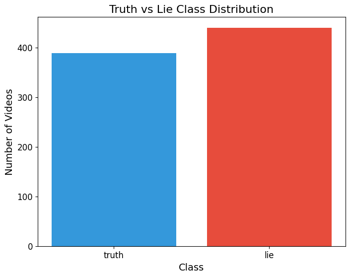 | 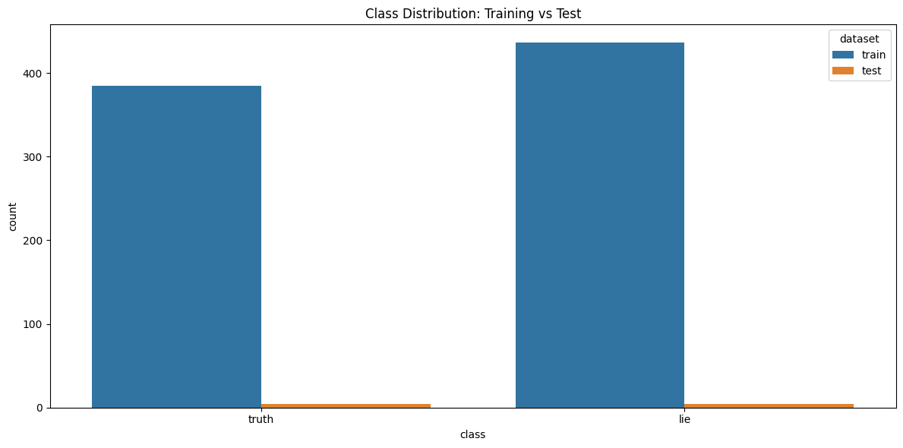 |
| **Class balance** — 440 lie / 389 truth | **Split composition** — note the tiny test set |
| 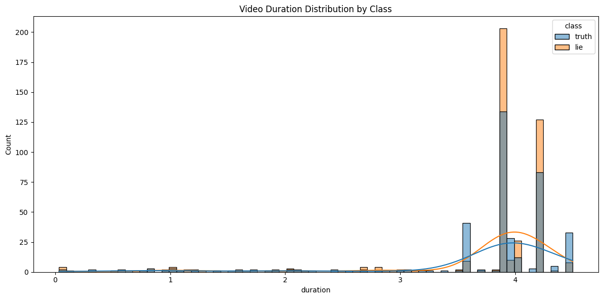 | 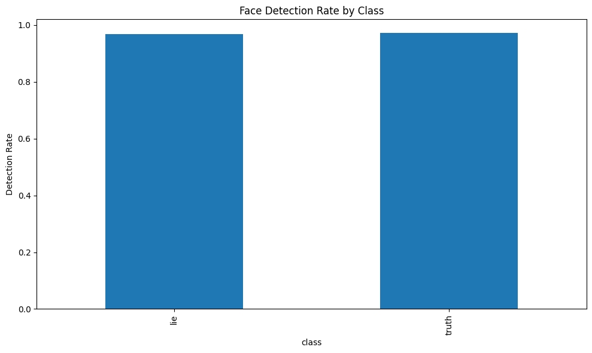 |
| **Clip durations** — tightly clustered near 3.9 s | **Face detection rate** by class |
| 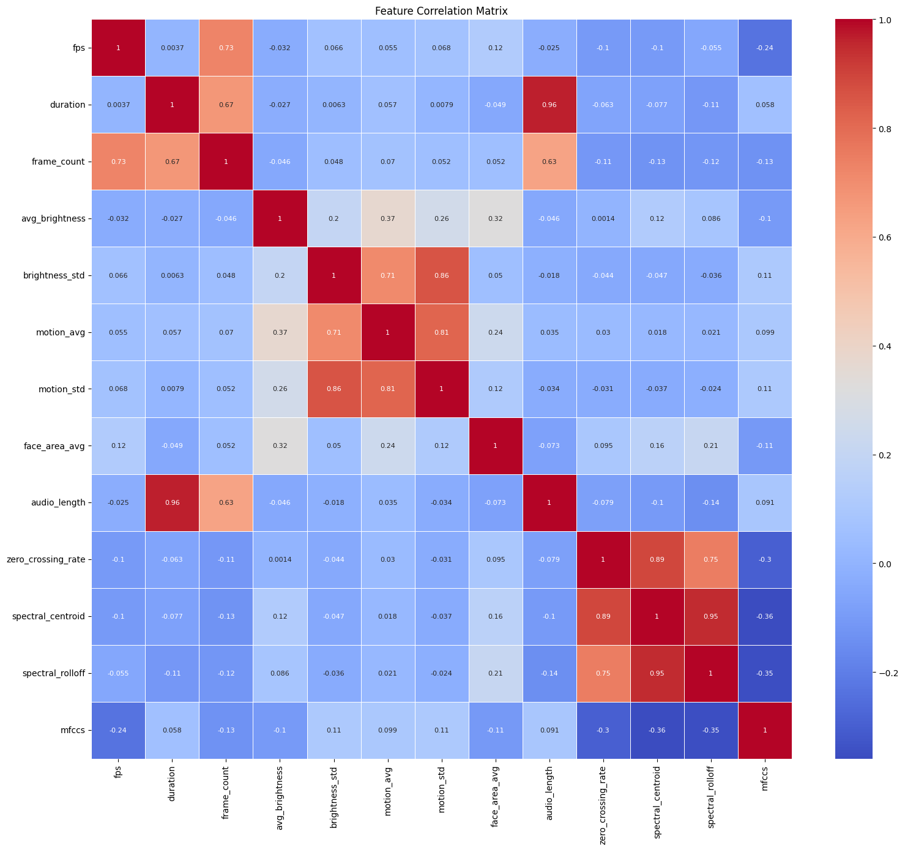 | 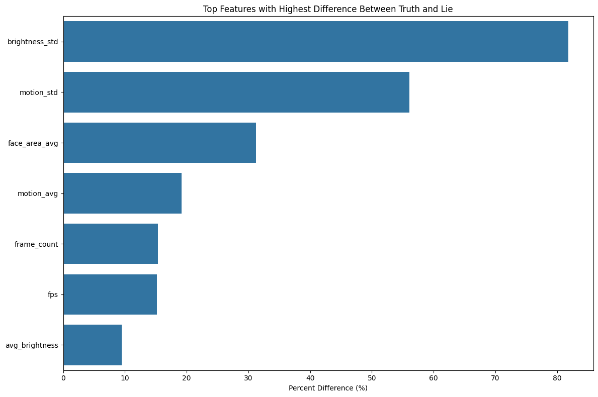 |
| **Feature correlation matrix** | **Features separating truth from lie** |

</div>

<details>
<summary>More EDA plots</summary>

| | |
|:---:|:---:|
| 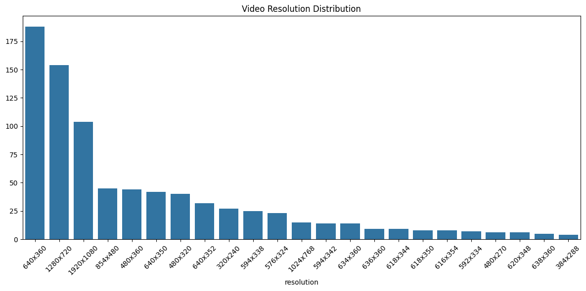 | 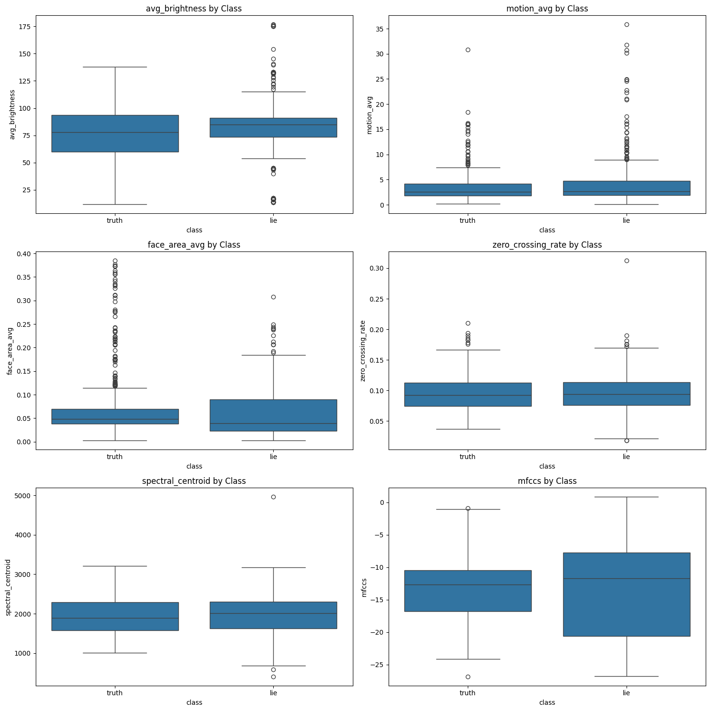 |
| **Resolutions present** | **Per-feature spread by class** |
| 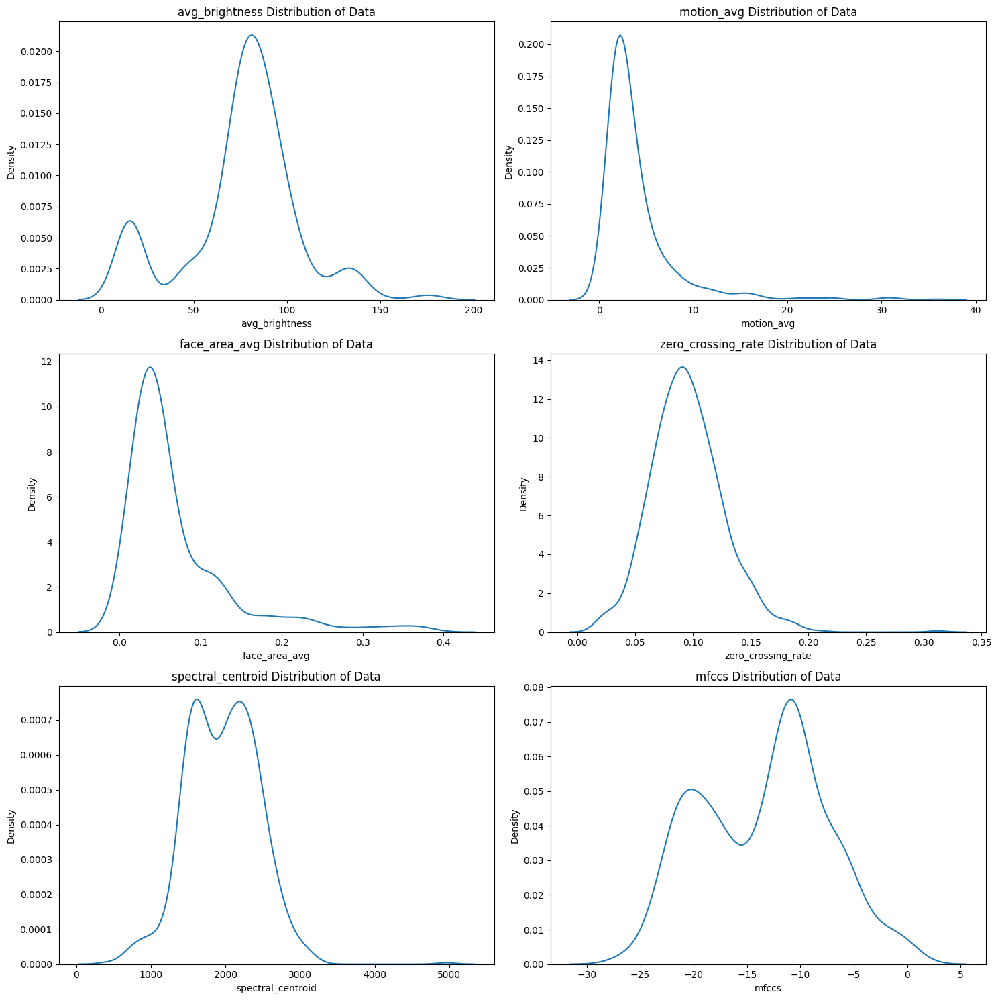 | |
| **Feature density estimates** | |

</details>

### CNN

98.0% accuracy, 0.9982 ROC AUC on the random-split validation set. Training accuracy passed 95% quickly and reached ~99% by epoch 30; validation started at 65–75% and reached ~96% by epoch 15.

Per-class — **note that `LabelEncoder` sorts alphabetically, so index 0 is `lie` and index 1 is `truth`**:

| Class | Precision | Recall | F1 | Support |
|---|---|---|---|---|
| 0 — lie | 0.97 | 0.98 | 0.98 | 66 |
| 1 — truth | 0.98 | 0.97 | 0.97 | 58 |

### RNN

<div align="center">

| 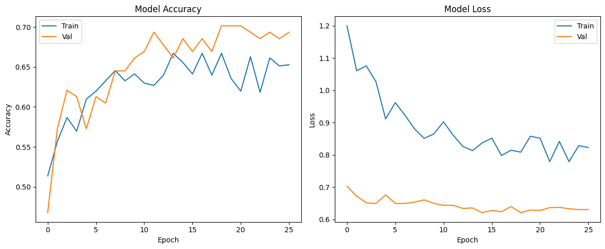 | 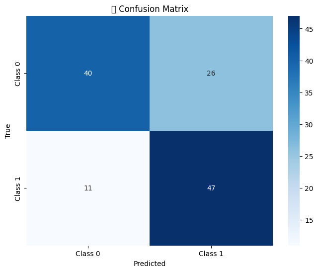 |
|:---:|:---:|
| **Training and validation curves** | **Confusion matrix** |

</div>

70.2% accuracy, 0.7369 ROC AUC. Training began near 51% and improved steadily; validation hovered at 60–70% and early stopping halted at epoch 26. `ReduceLROnPlateau` fired repeatedly, indicating the head struggled to extract signal from the pooled representation.

| Class | Precision | Recall | F1 | Support |
|---|---|---|---|---|
| 0 — lie | 0.78 | 0.61 | 0.68 | 66 |
| 1 — truth | 0.64 | 0.81 | 0.72 | 58 |

The RNN **over-predicts truth**: it catches 81% of genuine statements but misses 39% of lies. For a deception detector that is the more dangerous direction to fail in.

### Comparison

See the [model head diagram](#model-heads-cnn-vs-rnn) above for the side-by-side metrics. The CNN wins decisively on this representation — but since neither head receives the time axis, that result says nothing about convolution versus recurrence for video in general.

### Limitations & Honest Caveats

These are the things we would want a reviewer to know before believing any number above.

1. **The headline metrics are validation, not test.** The 8-clip test directory is unusable, so the pipeline evaluates on a slice of training data that also drove early stopping.
2. **Trial-level leakage inflates everything.** 829 clips from 109 trials, split randomly. The group-aware fix is implemented but the metrics have not been regenerated under it.
3. **Neither model sees temporal order.** Mean-pooling removes it before modelling.
4. **The CNN run is not captured in the committed notebook.** Its stored output stops partway through preprocessing, so the 98% comes from an earlier session. The RNN run *is* fully captured.
5. **Stored outputs predate the refactor.** The committed cell outputs come from runs before these code changes; re-run in Colab to regenerate them.
6. **The dataset is small and narrow.** 109 people, one setting (courtroom), one culture, one language. Deception cues are known to vary across all of those.
7. **17 clips have no usable audio and 25 have no detectable face**, and are represented by zero vectors — a small but real source of label-uncorrelated noise.

## Challenges & What We Learned

**Getting a suspiciously good number, and chasing it down.** The 98% felt too clean. Working backwards from the classification report's support counts — 66 and 58, summing to 124, which is exactly 15% of the 821 training clips — showed the "test" set was never used at all. That arithmetic is what unravelled the rest.

**Filenames as metadata.** Realising that `trial_lie_002_000` and `trial_lie_002_015` were fragments of the *same courtroom video* reframed the whole evaluation. 829 samples became 109 independent units. The lesson generalises: whenever your rows are segments of something larger, your split has to respect the larger thing.

**Alphabetical label encoding is a silent trap.** `LabelEncoder` sorts class names, so `lie` became 0 and `truth` became 1 regardless of the order `os.listdir()` returned. Reporting `"Class 0"` and `"Class 1"` instead of real names meant our per-class discussion was inverted for a long time — we were describing the lie class as the truth class. The fix is to never print an index where a name will do.

**Concurrency and temp files.** Four worker threads all wrote their demuxed audio to the same `temp_audio.wav`, racing to read and delete each other's file. It failed quietly — 17 clips came back with missing audio features and nothing crashed. Unique per-call filenames fixed it. Silent partial failure is far more expensive to debug than a crash.

**Memory arithmetic before `np.load`.** 821 × 30 × 224 × 224 × 3 bytes is about 11 GB. Loading the frame array eagerly only worked on a high-RAM runtime; `mmap_mode='r'` with per-batch slicing made it run anywhere.

**Shell strings versus argument lists.** `os.system(f"ffmpeg -i {path} ...")` breaks on any path containing a space and executes anything containing a semicolon. Passing a list to `subprocess.run` removes the entire class of problem.

## Future Improvements

- [ ] **Re-run under the group-aware split** and publish the honest metrics alongside the leaky ones.
- [ ] **Train a real temporal model** on the saved un-pooled `(30, 1280)` sequences — LSTM/GRU or a small transformer — for a fair recurrence comparison.
- [ ] **Fine-tune the visual encoder.** MobileNetV2 is frozen at ImageNet weights; unfreezing the last block would let it learn facial-motion cues specific to this task.
- [ ] **Leave-one-trial-out cross-validation** — with only 109 groups, a single split wastes data and gives a high-variance estimate.
- [ ] **Add explainability** (Grad-CAM over frames, attention over time). For a task this ethically loaded, a prediction without a reason is not useful.
- [ ] **Report confidence intervals**, not point estimates, on a dataset this small.
- [ ] **Validate cross-dataset** on a different deception corpus to test whether anything learned here transfers at all.

## Ethical Considerations

We want to be direct about this, because it would be easy to present this project as more than it is.

**This should not be used to make decisions about people.** Automated deception detection has a poor scientific track record, and the consequences of a false positive — being labelled a liar by a machine — are severe and hard to contest. A system trained on 109 people from a single courtroom context has no basis for generalising to anyone else.

Specific concerns:

- **Demographic bias is unmeasured.** We did not audit performance across age, gender, or ethnicity. On a 109-person dataset we could not have done so meaningfully.
- **Behavioural cues are not universal.** Gaze aversion, hesitation, and fidgeting vary across cultures, neurotypes, and stress responses. A nervous truthful person and a calm liar are exactly the cases that matter, and exactly the cases this cannot handle.
- **Courtroom video is not everyday video.** Everyone in the source data was under extreme stress. Those base rates do not transfer.
- **The subjects did not consent to this use.** The dataset is restricted to non-commercial academic research, and we have kept it that way — `data/` is gitignored, no clips or identifiable frames are committed to this repository.

This is coursework exploring what the techniques can and cannot do. Treating it as anything more would be a misuse of it.

## Project Structure

```
True-or-Lie-Detector-AI/
├── True_or_Lie_Detector_AI_Project.ipynb   # main notebook: EDA → preprocessing → both models
├── src/
│   ├── __init__.py
│   └── preprocessing.py                    # frame/audio extraction, trial_id, group_split
├── tests/
│   ├── test_split_integrity.py             # leakage guards (no TF or dataset needed)
│   └── test_preprocessing.py               # extractor contracts on synthetic media
├── docs/
│   ├── architecture.html                   # animated pipeline walkthrough
│   └── images/                             # EDA and results plots
├── data/                                   # gitignored — see Data Setup
├── processed_data/                         # gitignored — generated .npy/.pkl caches
├── requirements.txt
├── LICENSE
└── README.md
```

Helper functions live in `src/` rather than inline in the notebook so that the test suite can exercise them without a GPU or the 328 MB dataset. The notebook imports from there, so there is exactly one definition of each.

## Team

Group 01 — AI Module

| Name |
|---|
| Gunarathne A.N.G.T.N.B |
| Gunathilaka G.P.K.H |
| Piyumantha H.D.D.B.A |
| Rajapakshe R.M.M.L.D |

## References & Dataset Credit

1. Pérez-Rosas, V., Abouelenien, M., Mihalcea, R., & Burzo, M. (2015). *Deception Detection using Real-Life Trial Data.* ICMI 2015. [doi:10.1145/2818346.2820758](https://doi.org/10.1145/2818346.2820758)
2. Ekman, P., & Friesen, W. V. (1978). *Facial Action Coding System.* Consulting Psychologists Press.
3. Pérez-Rosas, V., Mihalcea, R., Narvaez, A., & Burzo, M. (2017). *A Multimodal Dataset for Deception Detection.* [ACL Anthology P17-2067](https://aclanthology.org/P17-2067/)
4. Wu, Z., Singh, B., Davis, L. S., & Subrahmanian, V. S. (2018). *Deception Detection in Videos.* AAAI. [arXiv:1712.04415](https://arxiv.org/abs/1712.04415)
5. Sandler, M., Howard, A., Zhu, M., Zhmoginov, A., & Chen, L.-C. (2018). *MobileNetV2: Inverted Residuals and Linear Bottlenecks.* [arXiv:1801.04381](https://arxiv.org/abs/1801.04381)
6. McFee, B., et al. *librosa: Audio and Music Signal Analysis in Python.* [librosa.org](https://librosa.org/doc/latest/index.html)
7. TensorFlow — [CNN tutorial](https://www.tensorflow.org/tutorials/images/cnn) · [Load video data](https://www.tensorflow.org/tutorials/load_data/video)

The literature survey in the notebook also refers to "Zhang et al. (2017)" and "Gupta and Chandra (2019)". We could not resolve these to specific papers when compiling this list, so they should be read as illustrative rather than as verifiable citations.

## License

Released under the [MIT License](LICENSE).

**The license covers this repository's source code only.** The Real-Life Trial Deception dataset is not covered, is not redistributed here, and remains restricted to non-commercial academic research under its own terms.
